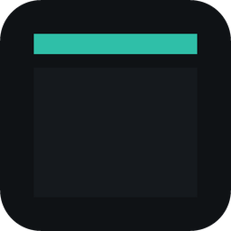
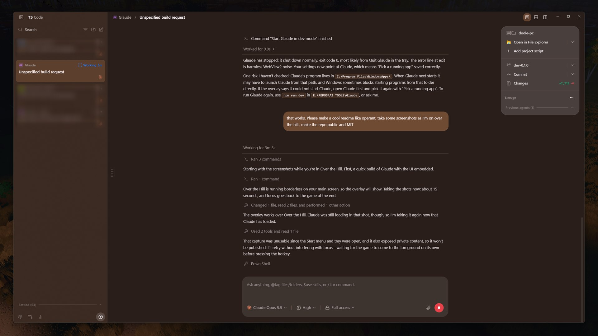
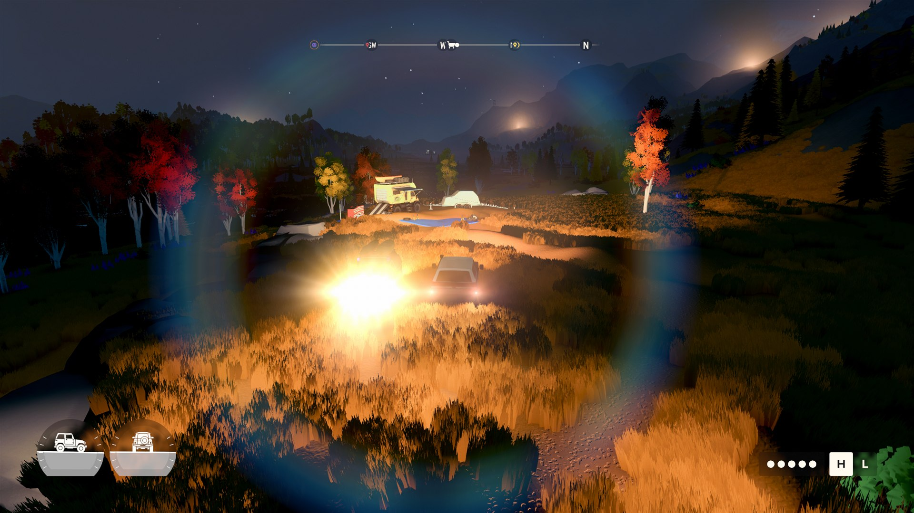

<p align="center">
  
</p>

<h1 align="center">Glaude</h1>

<p align="center">
  <strong>Check on your AI coding agents without leaving the game.</strong><br>
  One hotkey opens Claude, T3 Code, a terminal or any app in a panel over the dimmed game. The same key puts you back in the game.<br>
  No Alt-Tab, no injected code, nothing sent off your computer.
</p>

<p align="center">
  <a href="LICENSE"></a>
  
  
  
</p>

<p align="center">
  <a href="#quick-start">Quick start</a> ·
  <a href="#why-glaude">Why Glaude</a> ·
  <a href="#features">Features</a> ·
  <a href="#where-it-works">Where it works</a> ·
  <a href="#what-glaude-does-on-your-machine">What it does on your machine</a> ·
  <a href="#development">Development</a>
</p>

<p align="center">
  
</p>
<p align="center"><sub>T3 Code over Over the Hill, one key press from the game below.</sub></p>

---

You start an agent on a long task, then start a game while it works. Now you want to know if it is finished, or if it is stuck on a question. Alt-Tab drops you out of the game, some games minimise, and the mouse lock breaks. **Glaude is a small tray app that puts the agent's real window over the game and takes it away again with one key.** It does not draw inside the game: it moves the app's own window above it and hands focus back when you are done.

<p align="center">
  
  
</p>

## Quick start

There is no installer yet. Build it from source:

1. Install [Node.js](https://nodejs.org), [Rust](https://rustup.rs) and the [Tauri 2 requirements for Windows](https://tauri.app/start/prerequisites/).
2. In this folder run `npm install`, then `npm run dev`.
3. Left-click the Glaude tray icon, press **Pick a running app** and choose your agent's window.

That's it. In a game, press **Ctrl+`** (the key above Tab) to open the panel and press it again to go back.

## Why Glaude

**One key in, one key out.** The hotkey opens the panel and gives the app the keyboard straight away. The same key closes it and gives the game the foreground again, so its mouse lock comes back on its own. A click on the dim edge closes it too.

**Leave the game alone.** Steam and Discord draw their overlays by injecting code into the game. Glaude does not touch the game at all, so there is nothing for anti-cheat to object to.

**The app stays as it is.** What you see is the app's own window, not a copy or a restyle. You type into it as normal, and Esc stays with the app (Claude Code and OpenCode use Esc to stop a reply).

**Quick every time after the first.** Between opens the app keeps running out of sight, off-screen and off the taskbar. Opening takes a few milliseconds.

## Features

| Capability | What you get |
| --- | --- |
| Hotkey overlay | Ctrl+` opens the app in a panel 50px in from every edge of the game's monitor, over the game dimmed to 72% |
| Pick a running app | Choose any open window from a list; Glaude uses that window from the next open |
| Browse for a program | Pick any program (or its shortcut); Glaude starts it the first time you open the overlay |
| One-copy apps | Apps that only run once, like Claude and T3 Code, are taken over in their existing window instead of failing to start |
| Any keyboard layout | The hotkey is stored by key position, so Ctrl+` is the key above Tab on UK and US keyboards alike |
| Settings, applied live | Rebind the hotkey by pressing it, set the dim level, change the app; saved as you go |
| Multi-monitor and scaling | The panel opens on the monitor the game is on, measured in display-scaled pixels so it looks the same at 1080p and 4K |

## Where it works

| Game display mode | Overlay |
| --- | --- |
| Borderless window, most modern games' default | Works |
| Fullscreen with Fullscreen Optimisations on, the Windows 10 and 11 default | Works |
| True exclusive fullscreen | Does not show, because the game owns the screen. Switch the game to Borderless |

Some anti-cheat games pull focus back every frame. Glaude does not fight them for it.

Not built yet: several apps at once with a switcher strip, presets for Claude, T3 Code and OpenCode, an installer with automatic updates, and the About page. The plan is in the [design](docs/overlay-design.html) and the [bible](docs/bible.html).

## What Glaude does on your machine

- **Registers one global hotkey** (Ctrl+` unless you change it), and lets go of it while you record a new one.
- **Starts the program you chose**, the first time you open the overlay, with the arguments you gave.
- **Moves, shows and hides that program's window.** Between opens it is moved off-screen and hidden. When you quit Glaude, or choose a different app, the window is put back on screen as a normal window.
- **Keeps its settings** in `%APPDATA%\io.glaude.app\settings.json`.

## Privacy

Nothing leaves your computer. Glaude makes no network connections: no account, no analytics, no update checks yet. The AI apps you open in it send your prompts and files to their own services under their own terms, and Glaude neither sees nor controls that.

## Development

```sh
npm install          # once
npm run dev          # run the working tree with live reload
npm run main         # run the main branch from a clean copy in build/main-run
```

The code is small: `src-tauri/src/overlay.rs` (shade and app window), `hotkey.rs` (the global hotkey), `win.rs` (the Windows calls) and `settings.rs`, plus two Svelte pages in `ui/src`. How the parts fit is in [docs/systems.md](docs/systems.md) and the reasons in [docs/design.md](docs/design.md).

## Credits

The Windows tricks Glaude uses (showing a window without taking focus, parking a window off-screen, letting go of shortcuts while another window needs them) come from my other project, Notifi. Over the Hill, shown in the screenshots, belongs to its makers. Glaude is not connected with it.

## Licence

MIT. See [LICENSE](LICENSE). Copyright (c) 2026 doolecg.

## Disclaimer

This software is provided "as is", without warranty of any kind, as set out in the [LICENSE](LICENSE). To the extent permitted by law, the authors are not liable for any loss or damage from using it, including lost data, lost work or damage to files or projects. Nothing here limits liability that cannot be limited by law, such as for death or personal injury caused by negligence.

Not affiliated with or endorsed by Anthropic, T3 Code, OpenCode or the makers of any game. Their names are used only to say what Glaude works with. Glaude only opens other programs. The AI apps you run in it can be wrong, so check their output before relying on it, and read their own terms for what data they send.

Back up your work before using it. You use it at your own risk.
